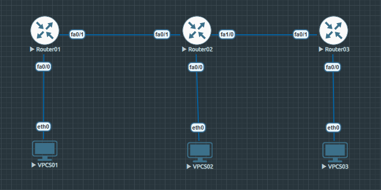

# OSPF Single-Area Routing Configuration

## Overview
This lab demonstrates OSPF dynamic routing between three Cisco routers using a single OSPF area (Area 0). End-to-end connectivity was verified between three LANs using VPCS nodes in EVE-NG.

## Objectives
- Configure OSPF on three Cisco routers.
- Establish OSPF neighbor adjacencies.
- Advertise LAN and transit networks in Area 0.
- Verify dynamically learned OSPF routes.
- Test end-to-end connectivity between all three LANs.

## Topology



**Topology:** VPCS01 — Router01 — Router02 — Router03 — VPCS03, with VPCS02 connected to Router02's LAN.

## IP Addressing

| Device | Interface | IP Address |
|      ---       |       ---       |      ---        |
| Router01       | FastEthernet0/0 | 192.168.1.1/24  |
| Router01       | FastEthernet0/1 | 10.0.12.1/30    |
| Router02       | FastEthernet0/0 | 192.168.2.1/24  |
| Router02       | FastEthernet0/1 | 10.0.12.2/30    |
| Router02       | FastEthernet1/0 | 10.0.23.1/30    |
| Router03       | FastEthernet0/0 | 192.168.3.1/24  |
| Router03       | FastEthernet0/1 | 10.0.23.2/30    |
| VPCS01         |        —        | 192.168.1.10/24 |
| VPCS02         |        —        | 192.168.2.10/24 |
| VPCS03         |        —        | 192.168.3.10/24 |

## OSPF Configuration Summary

| Router   | OSPF Process ID | Router ID | Area |

| Router01 |       1         |  1.1.1.1  |   0  |
| Router02 |       2         |  2.2.2.2  |   0  |
| Router03 |       3         |  3.3.3.3  |   0  |

Each router advertises its local LAN and directly connected transit networks through OSPF. Process IDs are locally significant and do not need to match between routers.

## Configuration Files
- [Router01 Configuration](configs/router01-config.txt)
- [Router02 Configuration](configs/router02-config.txt)
- [Router03 Configuration](configs/router03-config.txt)

## Verification Evidence
- [OSPF Neighbor Verification](verification/ospf-neighbors.txt)
- [OSPF Routing Table Verification](verification/ospf-routing-tables.txt)
- [End-to-End Connectivity Tests](verification/connectivity-tests.txt)

## Verification Results
- OSPF neighbors reached the FULL state.
- All three routers learned the expected remote networks through OSPF.
- Six directed ping tests between the three VPCS LANs received successful replies.

## OSPF Troubleshooting and Failure Analysis

This section extends the single-area OSPF lab with controlled failure testing, route withdrawal, and recovery verification using the same EVE-NG topology.

### Scenario 1: Transit Interface Failure

**Action:** Shut down Router01 FastEthernet0/1.

**Observed result:**
- The OSPF neighbor relationship between Router01 and Router02 was lost.
- Remote OSPF routes became unavailable.
- Connectivity to networks beyond the failed transit link was interrupted.

**Observed recovery result:**
- The OSPF adjacency was re-established after the interface was restored.
- Remote OSPF routes were learned again.
- End-to-end connectivity was restored.

### Scenario 2: Missing LAN Network Advertisement

**Action:** Remove the OSPF network statement for `192.168.3.0/24` from Router03.

**Observed result:**
- Router01's OSPF neighbor relationship with Router02 remained FULL.
- The route to `192.168.3.0/24` disappeared from Router01's routing table.

**Recovery:** Restore the network statement on Router03. Router01 relearned `192.168.3.0/24` through next hop `10.0.12.2`, originating from Router ID `3.3.3.3`, with OSPF metric `21`.

### Scenario 3: End-to-End Connectivity Recovery

After restoring the OSPF advertisement, VPCS01 successfully pinged `192.168.3.10`. The received replies showed TTL `61`.

### Troubleshooting Commands

```text
show ip ospf neighbor
show ip route ospf
show ip route 192.168.3.0
show running-config | section ospf
```
### Key Findings

- OSPF adjacency and route advertisement are separate concepts.
- A transit interface failure can remove the neighbor adjacency and associated remote routes.
- A missing network advertisement can withdraw a specific route while an existing neighbor adjacency remains FULL.
- Restoring the interface or advertisement allows routing and connectivity to recover.
- The linear topology has no alternate path for failover.

## Key Learning Points
- Configuring OSPF dynamic routing in a single area.
- Understanding OSPF router IDs and locally significant process IDs.
- Verifying neighbor adjacencies with `show ip ospf neighbor`.
- Identifying OSPF-learned routes with `show ip route ospf`.
- Understanding OSPF administrative distance and route metrics.
- Verifying end-to-end connectivity across multiple routed networks.

## Lab Environment
- EVE-NG
- Cisco IOS 3725 routers
- VPCS end devices

## Lab Status
**Completed — OSPF neighbor formation, route learning, and end-to-end connectivity verified.**
