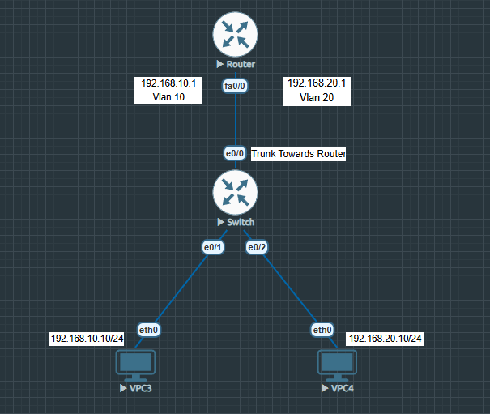

# Lab 01: VLAN Configuration, 802.1Q Trunking & Inter-VLAN Routing

## Overview

This lab demonstrates how to segment a network using VLANs and enable communication between VLANs using Router-on-a-Stick inter-VLAN routing.

The lab was built and tested in EVE-NG using a Cisco router, a Cisco Layer 2 switch, and two VPCS nodes.

## Objectives

- Create VLAN 10 and VLAN 20 on the Layer 2 switch.
- Assign switch access ports to the correct VLANs.
- Configure an 802.1Q trunk between the switch and router.
- Configure router subinterfaces for inter-VLAN routing.
- Assign IP addresses and default gateways to the VPCS nodes.
- Verify connectivity using ping tests.
- Understand packet flow between devices in the same VLAN and across different VLANs.
- Practice troubleshooting VLAN, trunking, and routing issues.

## Topology

**Devices:** 1 Cisco router, 1 Cisco Layer 2 switch, and 2 VPCS nodes.

The following diagram shows the EVE-NG topology used to configure VLAN 10, VLAN 20, 802.1Q trunking, and Router-on-a-Stick inter-VLAN routing.

## Technologies and Concepts

- VLAN 10 and VLAN 20
- Access ports
- IEEE 802.1Q trunking
- Router subinterfaces
- Router-on-a-Stick
- IP addressing and default gateways
- Inter-VLAN routing
- Ping verification
- Packet-flow analysis

## Network Design

| Device | Role | VLAN / Interface | IP Address |
|---|---|---|---|
| VPCS 1 | End device | VLAN 10 | To be documented |
| VPCS 2 | End device | VLAN 20 | To be documented |
| Layer 2 switch | VLAN and access/trunk switching | Access ports and router uplink | As configured |
| Cisco router | Inter-VLAN routing | 802.1Q subinterfaces | To be documented |

The exact IP addresses, subnet masks, VLAN access ports, and router interfaces will be recorded from the verified lab configuration.

## Configuration

The router and switch configurations will be saved as separate files in the `configs/` directory.

- Router configuration: `configs/router-config.txt`
- Switch configuration: `configs/switch-config.txt`

## Verification and Results

The following verification evidence will be added after collecting the outputs from the completed lab:

- VLAN membership and access-port verification
- Trunk status and allowed VLAN verification
- Router subinterface and IP-address verification
- Routing-table verification
- Ping results between the VPCS nodes
- Relevant command outputs and screenshots

## Packet Flow

For communication between devices in different VLANs:

1. The source VPCS sends an Ethernet frame toward its configured default gateway.
2. The switch forwards the frame over the trunk, carrying the VLAN identification using 802.1Q tagging.
3. The router's corresponding subinterface receives the frame and performs Layer 3 routing.
4. The router forwards the packet toward the destination VLAN through the appropriate subinterface.
5. The switch delivers the resulting Ethernet frame to the destination access port.

## Troubleshooting Notes

Issues encountered, root causes, corrective commands, and final verification results will be documented here after reviewing the actual lab experience.

## Outcome

This lab demonstrates VLAN segmentation, 802.1Q trunking, and inter-VLAN communication using Router-on-a-Stick.

## Environment

- Network emulator: EVE-NG
- Devices: Cisco router, Cisco Layer 2 switch, VPCS
- Documentation: GitHub
